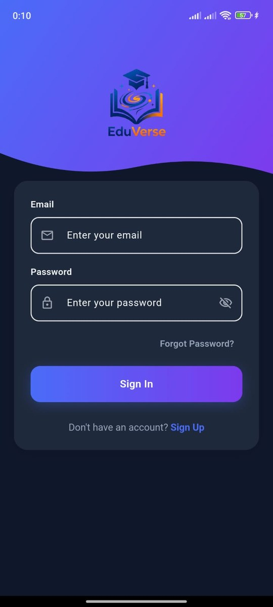
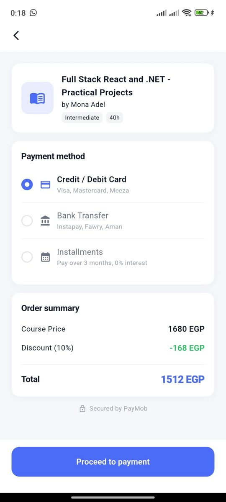
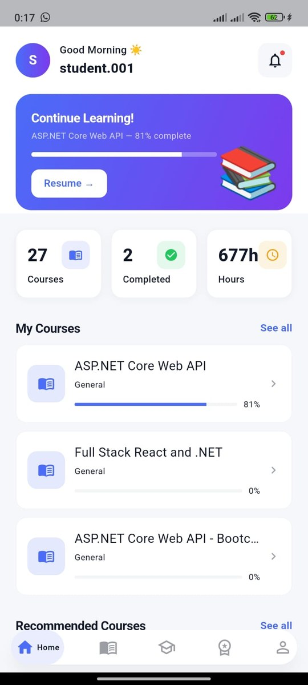
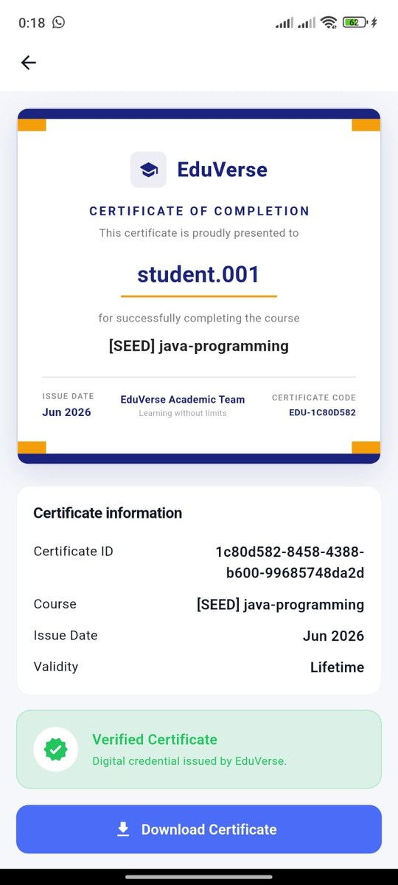
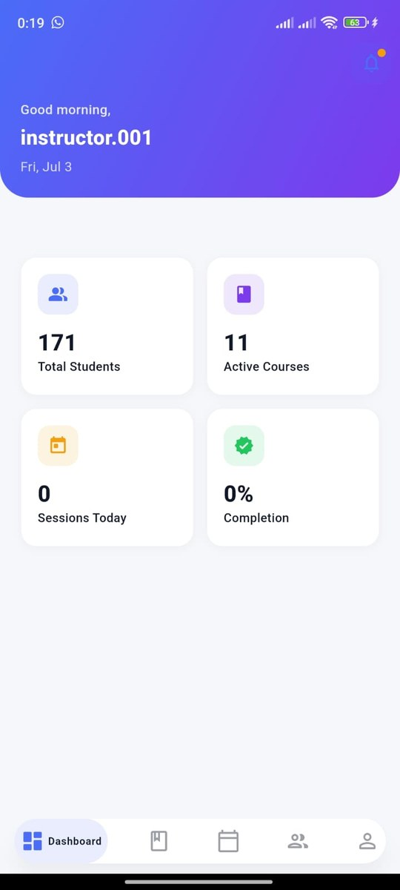
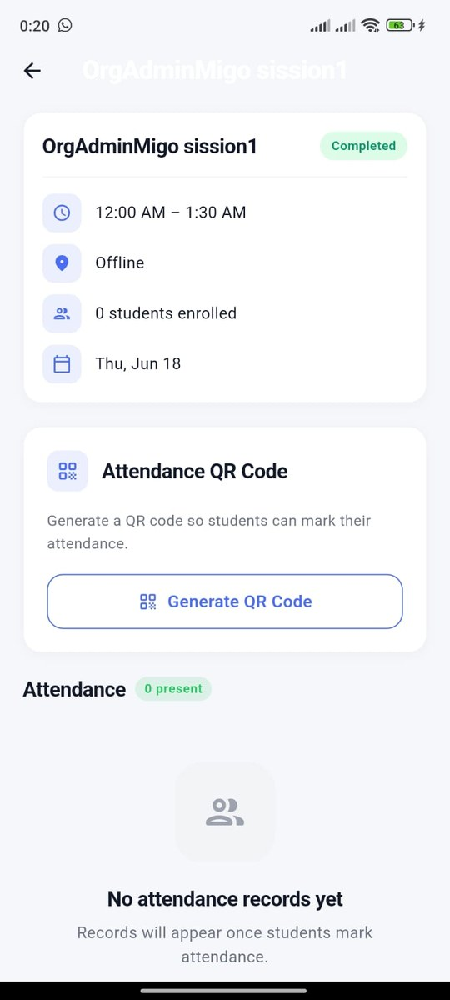

<div align="center">

# EduVerse

**A full-featured e-learning mobile platform built with Flutter**

[](https://flutter.dev)
[](https://dart.dev)
[](https://flutter.dev)
[](https://blog.cleancoder.com/uncle-bob/2012/08/13/the-clean-architecture.html)

</div>

---

## About

EduVerse is a cross-platform mobile application that connects students with instructors in an online learning environment. Students can browse and enroll in courses, watch video lessons, track attendance, submit assignments, earn certificates, and pay securely via PayMob. Instructors can create and manage courses, upload content, and monitor their students.

---

## Screenshots

### Student

| Sign in | Browse courses | Course detail |
|---|---|---|
|  |  |  |

| Checkout (PayMob) | My learning | Certificate |
|---|---|---|
|  |  |  |

### Instructor

| Dashboard | Attendance QR | Grading |
|---|---|---|
|  |  |  |

---

## Features

### Student
- Browse the course catalog with personalised and trending recommendations
- Enroll in courses with PayMob payment integration (Card, Bank Transfer, Installments)
- Stream video lessons with an in-app media player
- Track attendance via QR code scanning
- Submit and view assignments
- Download payment receipts as PDF
- View and download earned certificates
- Manage profile and account settings

### Instructor
- Create and publish courses with cover images
- Upload course materials and video content
- Monitor enrolled students
- Manage course sessions

### General
- JWT-based authentication with OTP email verification
- Forgot password / reset password flow
- Dark & light theme support
- Localization-ready (flutter_localizations)

---

## Tech Stack

| Layer | Technology |
|---|---|
| Framework | Flutter 3 / Dart 3 |
| State Management | flutter_bloc (Cubit) with custom generic states |
| Dependency Injection | get_it (manual registration) |
| Navigation | go_router |
| Networking | Dio (auth + logging interceptors) over 12 typed API service classes |
| Local Storage | shared_preferences |
| Media Player | media_kit + media_kit_video |
| Image Loading | cached_network_image |
| PDF Generation | pdf + printing |
| QR Scanner | mobile_scanner |
| Payment | PayMob (Unified Checkout) |
| Backend | ASP.NET Core REST API |
| Cloud Storage | Azure Blob Storage |

---

## Architecture

The project follows **Clean Architecture** with a feature-first folder structure:

```
lib/
├── core/                   # Shared utilities, theme, navigation, constants
├── config/                 # DI setup, Dio interceptors, base state/response
├── features/
│   ├── auth/               # Login, Register (OTP), Forgot Password
│   │   ├── data/           # DataSources, Repositories, Models
│   │   ├── domain/         # Repository interfaces, Use Cases
│   │   └── ui/             # Cubits, Screens
│   ├── instructor/         # Instructor dashboard & course management
│   └── onboarding/         # App intro screens
└── student/
    └── features/
        ├── home/           # Recommended courses feed
        ├── courses/        # Course catalog & detail
        ├── enrollment/     # Enrollment flow & PayMob checkout
        ├── learning/       # Video player & lesson content
        ├── assignments/    # Assignment submission
        ├── attendance/     # QR-based attendance
        ├── certificates/   # Certificate viewer & download
        ├── notifications/  # In-app notification feed
        └── profile/        # User profile management
```

---

## Getting Started

### Prerequisites

- Flutter SDK `^3.8.1`
- Dart SDK `^3.0`
- Android Studio / VS Code
- A connected Android/iOS device or emulator

### Installation

```bash
# 1. Clone the repository
git clone https://github.com/MostafaAkram-off/EduVerse.git
cd EduVerse

# 2. Install dependencies
flutter pub get

# 3. Run the app
flutter run
```

### Build Release APK

```bash
flutter build apk --release
```

---

## Backend

The app connects to a live ASP.NET Core REST API:

```
https://eduverseapi.azurewebsites.net
```

Authentication uses JWT tokens persisted on-device. All API communication goes through a Dio client with an interceptor that attaches the bearer token to every request and clears the session on a 401 response.

---

## Payment

Payments are handled via **PayMob Unified Checkout**. When a student enrolls in a paid course, the app calls the backend to create a PayMob order and receives a checkout URL. The URL is opened in the device's browser where the student completes payment, then returns to the app.

Supported payment methods (configured on PayMob dashboard):
- Credit / Debit Card
- Bank Transfer (Instapay, Fawry, Aman)
- Installments

---

## Roadmap

- [ ] Move JWT storage from `shared_preferences` to `flutter_secure_storage`
- [ ] Migrate the API service layer to Retrofit and models to Freezed / json_serializable (dependencies are already in `pubspec.yaml`)
- [ ] Unit tests for use cases and widget tests for key screens
- [ ] Full Arabic localisation (the app is already localisation-ready)

## Author

**Mostafa Akram** — Flutter Developer

[GitHub](https://github.com/MostafaAkram-off) · [LinkedIn](https://www.linkedin.com/in/mostafaakram-dev/)

## License

This project is for educational and portfolio purposes.
